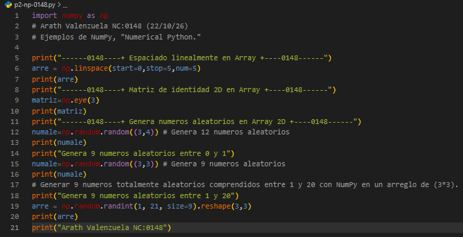
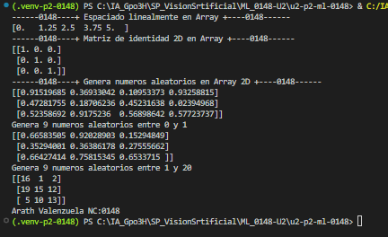

## arre = np.linspace(start=0,stop=1,num=5)
- `arre`: Nombre de la variable. 
- `start=0`: Valor inicial de la secuencia.
- `stop=1`: Valor final de la secuencia (sin incluirlo exactamente si no coincide con los intervalos).
- `num=5`: Cantidad de valores que se van a generar.

## Que es np.linspace? 
Es una funcion dentro de la librería de NumPy, `linspace` genera una cantidad determinada de valores distribuidos uniformemente entre un valor inicial (`start`) y uno final (`stop`), incluyendo ambos extremos por defecto.

## El código 

## Resultados 
